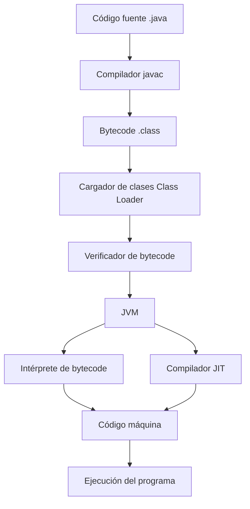
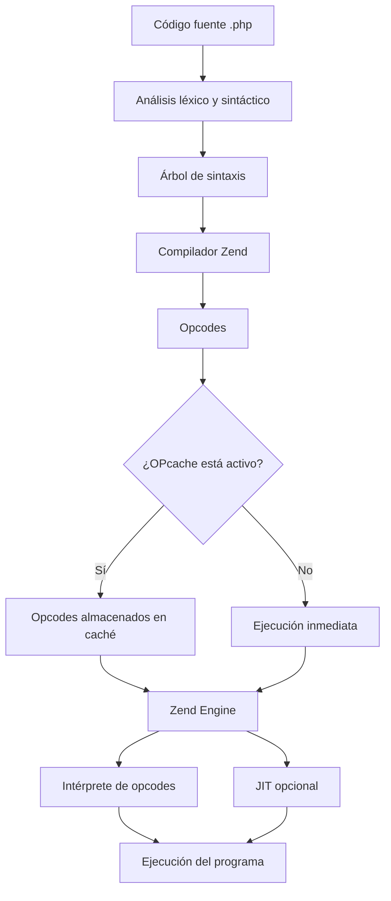
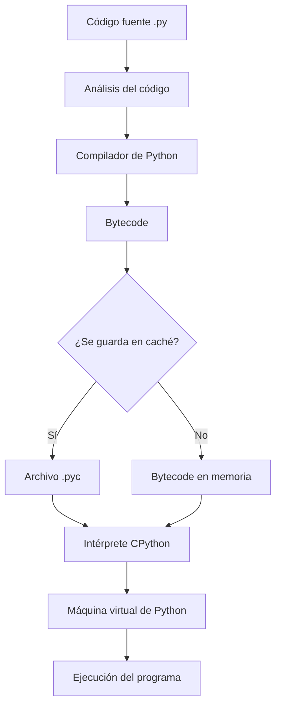
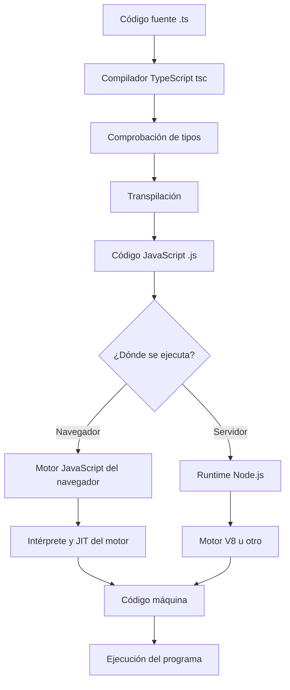

 # AP106-Mohamed Amin Ben Assad El Arine
Mohamed Amin Ben Assad El Arine
**Módulo:** Entornos de Desarrollo  
**Curso:** 1.º DAW
### Investigación comparativa: Java, PHP, Python y TypeScript
## 1. Del código fuente al ejecutable
Cómo se transforma el código fuente de cada lenguaje hasta que puede ejecutarse.
### 1.1. Java: del archivo .java a la JVM
*Java* utiliza un compilador llamado javac, que se encarga de convertir el código fuente en bytecode. Este bytecode se ejecuta dentro de la Máquina Virtual de Java (JVM).
Lo interesante de Java es que no genera directamente un ejecutable específico para Windows o Linux, sino un código intermedio que puede utilizarse en diferentes sistemas operativos si tienen una JVM compatible.

*Elementos principales:*
* Archivo .java: es el archivo donde escribimos el código.
* Compilador javac: transforma el código fuente en bytecode.
* Bytecode .class: es el código intermedio que utiliza Java.
* Class Loader: se encarga de cargar las clases que necesita el programa.
* Verificador: comprueba que el bytecode sea válido.
* JVM: es la máquina virtual que permite ejecutar el programa.
* Intérprete: ejecuta las instrucciones del bytecode.
* JIT: convierte algunas partes del bytecode en código máquina para mejorar la velocidad.
  

---
### 1.2 PHP : del archivo .php a su ejecución
*PHP* se utiliza principalmente para desarrollar páginas web desde el servidor. Cuando se ejecuta un archivo PHP, el motor Zend analiza el código y lo transforma en unas instrucciones intermedias llamadas opcodes. Después, Zend Engine se encarga de ejecutar estas instrucciones. Además, PHP dispone de herramientas como OPcache y JIT, que pueden ayudar a mejorar el rendimiento.

*Elementos principales:*
* Archivo .php: contiene el código fuente.
* Zend Engine: es el motor que se encarga de procesar y ejecutar PHP.
* Opcodes: son las instrucciones intermedias que genera el motor.
* OPcache: guarda los opcodes para no tener que generarlos continuamente.
* JIT: permite convertir determinadas partes del código en código máquina.

---
### 1.3. Python: del archivo .py a su ejecución
Python es conocido por ser un lenguaje sencillo de aprender y utilizar. Aunque muchas veces se dice que es un lenguaje interpretado, en su implementación más habitual, CPython, primero se transforma el código fuente en bytecode.Este bytecode es ejecutado por la máquina virtual de Python. También puede almacenarse en archivos .pyc para reutilizarlo en determinadas ocasiones.

*Elementos principales:*
* Archivo .py: contiene el código que escribe el programador.
* Compilador de Python: transforma el código fuente en bytecode.
* Bytecode: son las instrucciones intermedias del programa.
* Archivo .pyc: permite almacenar el bytecode compilado.
* CPython: es la implementación más utilizada de Python.
* Máquina virtual: ejecuta las instrucciones del bytecode.

---
### 1.4. TypeScript: del archivo .ts a JavaScript
TypeScript es una extensión de JavaScript que incorpora un sistema de tipos. Esto permite detectar ciertos errores antes de ejecutar el programa.
Sin embargo, los navegadores no ejecutan TypeScript directamente. Primero se transforma en JavaScript mediante el compilador tsc. Después, el código JavaScript puede ejecutarse en un navegador o en un entorno como Node.js.

*Elementos principales:*
* Archivo .ts: contiene el código escrito en TypeScript.
* Compilador tsc: comprueba los tipos y transforma el código.
* Transpilación: consiste en convertir el código de TypeScript a JavaScript.
* Archivo .js: es el código que se ejecutará finalmente.
* Motor JavaScript: interpreta y ejecuta el código.
* JIT: optimiza determinadas partes del código convirtiéndolas en código máquina.

## 2. Análisis del rendimiento en el primer arranque

### 2.1. ¿Qué es la compilación Just-In-Time (JIT)?
La compilación JIT, también conocida como Just-In-Time, consiste en transformar determinadas partes de un programa en código máquina mientras se está ejecutando.
Esto permite que el programa no tenga que interpretar continuamente las mismas instrucciones. El JIT identifica las partes del código que se utilizan más y las optimiza para que funcionen más rápido.

    
### 2.2. ¿Por qué Java puede ser más lento la primera vez que se ejecuta?
Java puede tardar algo más en arrancar la primera vez porque la JVM tiene que cargar las clases, comprobar el bytecode e interpretar las primeras instrucciones.
A medida que el programa se ejecuta, el JIT puede detectar las partes que se utilizan frecuentemente y compilarlas en código máquina.
A este proceso se le conoce como calentamiento o warm-up. Por eso, en algunos programas Java, las siguientes ejecuciones pueden ser más rápidas que las primeras. De todas formas, esto depende del programa, ya que no todos se benefician de la misma manera de las optimizaciones del JIT.

### 2.3. ¿PHP, Python y TypeScript también tienen JIT?
Los cuatro lenguajes pueden aprovechar técnicas de compilación JIT, aunque no funcionan exactamente igual.
--->AQUI VA UNA TABLA

En PHP, el JIT puede mejorar el rendimiento en determinados casos, aunque en una página web también influyen mucho las consultas a bases de datos y otros procesos.

En Python, la implementación CPython es la más habitual, pero existen otras como PyPy que utilizan JIT para mejorar la velocidad.

En TypeScript, el JIT no pertenece al propio lenguaje. Es el motor JavaScript el que se encarga de optimizar el código una vez transformado.

## 3. La magia de la multiplataforma

### 3.1. ¿Por qué Java, PHP y Python son considerados multiplataforma?
Un lenguaje multiplataforma permite utilizar un mismo programa en diferentes sistemas operativos sin tener que escribirlo de nuevo desde cero.

Java:

Java utiliza la JVM para ejecutar el bytecode. Esto permite que el mismo programa pueda funcionar en Windows, Linux o macOS, siempre que exista una JVM compatible.
Por eso se utiliza la expresión:

<<<Write Once, Run Anywhere.>>>
Es decir, escribir el programa una vez y poder ejecutarlo en diferentes plataformas.

PHP:

PHP dispone de intérpretes para distintos sistemas operativos. Por ejemplo, podemos desarrollar una aplicación en Windows y ejecutarla en un servidor Linux que tenga PHP instalado.

Python:

Python también puede utilizarse en diferentes sistemas operativos. Basta con tener instalado un intérprete compatible y las librerías que necesite el programa.

### 3.2. ¿TypeScript es realmente multiplataforma?
Sí, TypeScript también se puede considerar multiplataforma.

Esto se debe a que se transforma en JavaScript, que puede ejecutarse en diferentes entornos, como los navegadores web o Node.js.

La diferencia respecto a Java es que TypeScript no necesita una máquina virtual propia, sino que utiliza los motores de JavaScript disponibles en cada entorno.

### 3.3. ¿Se puede aplicar «Write Once, Run Anywhere» a PHP, Python y TypeScript?
La idea también puede aplicarse a estos lenguajes, aunque de una forma diferente.
- Java: utiliza el bytecode y la JVM.
- PHP: utiliza su intérprete instalado en el sistema.
- Python: utiliza un intérprete compatible con el código.
- TypeScript: utiliza la transpilación a JavaScript y un motor JavaScript.
En los cuatro casos se puede reutilizar gran parte del código en diferentes plataformas, siempre que se disponga del entorno adecuado.

No obstante, la multiplataforma no es absoluta. Las dependencias, el acceso a archivos, las librerías nativas o las características específicas de un sistema operativo pueden provocar diferencias.

## 4. Tabla comparativa final

| Característica | Java | PHP | Python | TypeScript |
|---|---|---|---|---|
| Nivel de abstracción | Alto | Alto | Alto | Alto |
| Mecanismo de traducción | Compilación a bytecode | Compilación a opcodes | Compilación a bytecode | Transpilación a JavaScript |
| Tipado | Estático y fuerte | Dinámico | Dinámico | Estático |
| Paradigma principal | Orientado a objetos | Multiparadigma | Multiparadigma | Multiparadigma |
| Compilador/Intérprete | javac y JVM | Zend Engine | CPython | tsc y motor JS |
| Máquina virtual | JVM | Zend VM | Máquina virtual de CPython | Motor JavaScript |
| Código intermedio | Bytecode `.class` | Opcodes | Bytecode `.pyc` | JavaScript `.js` |
| Multiplataforma | Sí, mediante JVM | Sí, mediante intérprete | Sí, mediante intérprete | Sí, mediante motores JS |
| Rendimiento | Alto con JIT | Variable, JIT opcional | Variable según implementación | Depende del motor JS |
| Casos de uso típicos | Aplicaciones empresariales, Android, backend | Desarrollo web, servidores, CMS | IA, automatización, análisis de datos | Aplicaciones web, frontend, backend |

## 5. Conclusión final
Después de realizar esta investigación, he comprendido que los cuatro lenguajes de programación tienen diferentes formas de transformar el código fuente para que pueda ser ejecutado por un ordenador.

Java utiliza un compilador que transforma el código fuente en bytecode, el cual es ejecutado por la JVM. PHP utiliza Zend Engine para generar y ejecutar opcodes. Python, mediante CPython, compila el código a bytecode y posteriormente lo ejecuta mediante su intérprete. Por último, TypeScript se transpila a JavaScript, que es ejecutado por un motor JavaScript.

En cuanto al rendimiento, Java destaca por el uso de la JVM y el compilador JIT, que permiten optimizar la ejecución del programa. PHP también dispone de JIT, aunque su utilización es opcional. Python destaca por su facilidad de aprendizaje y sus aplicaciones en inteligencia artificial y análisis de datos. TypeScript resulta especialmente útil en el desarrollo web porque incorpora un sistema de tipos que facilita la detección de errores.

Respecto a la multiplataforma, los cuatro lenguajes permiten reutilizar código en diferentes sistemas operativos, aunque necesitan un entorno compatible para ejecutarse.

En conclusión, no existe un lenguaje que sea el mejor en todos los aspectos. Java es una buena opción para aplicaciones empresariales, PHP para desarrollo web del lado del servidor, Python para automatización e inteligencia artificial y TypeScript para desarrollar aplicaciones web modernas. La elección depende de las necesidades del proyecto, del rendimiento requerido y de las herramientas disponibles.

## 6. Fuentes y bibliografía consultadas
- Oracle. Java Virtual Machine Specification. Documentación oficial de Java.
- Oracle. The Java Programming Language Compiler, javac. Documentación del compilador Java.
- PHP. PHP Manual: OPcache. Manual oficial de PHP. 
  Manual+1
- Python Software Foundation. Python Glossary: Bytecode. Glosario oficial de Python. 
  3.15.2+1
- Microsoft. Transpiling TypeScript. Documentación de TypeScript. 
  Visual Stud

# Asegurandome de que git guarde est aversion 1